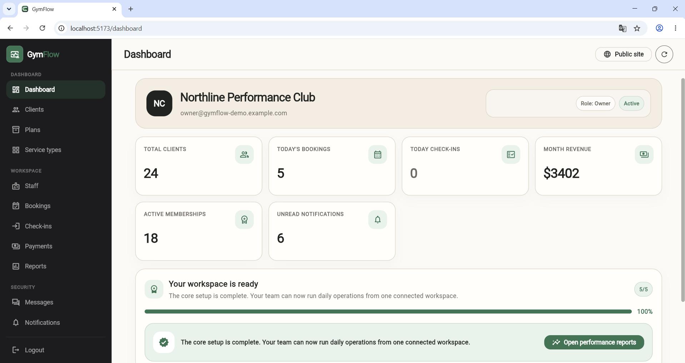
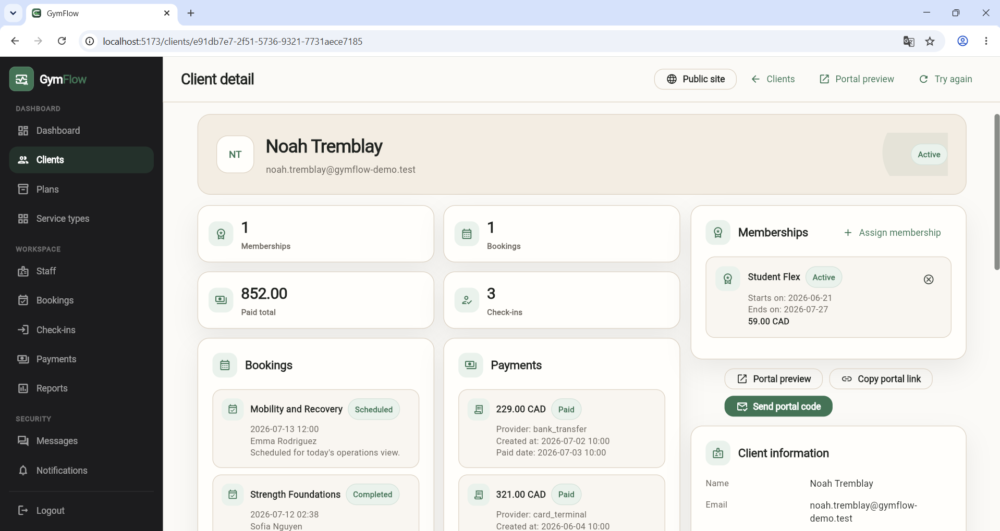
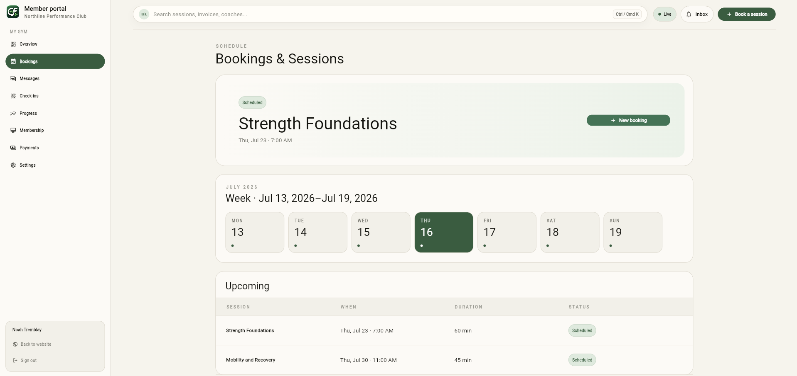
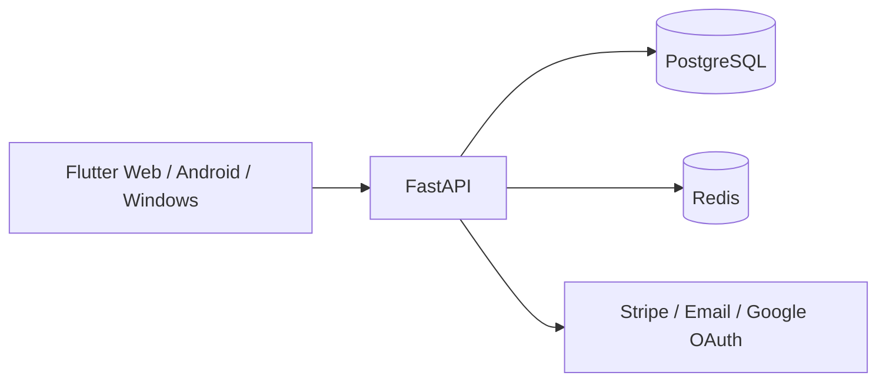

# GymFlow

**Multi-tenant gym management built with Flutter and FastAPI.**

GymFlow connects a studio's daily operations with client self-service. The system covers memberships, scheduling, attendance, payments, reporting, and communication through a shared workspace model. This repository documents a reviewed implementation snapshot; the application source is maintained separately.

## Product

| Surface | Audience | Primary workflows |
| --- | --- | --- |
| Public site | Visitors and prospective studios | Product information, pricing, registration |
| Staff application | Owners, managers, trainers, receptionists | Clients, services, bookings, check-ins, payments, reports |
| Client portal | Studio members | Bookings, memberships, receipts, check-in pass, support |

The interface supports English, French, and Arabic with right-to-left layouts. The Flutter application targets Web, Android, and Windows.

| Staff operations | Client portal |
| --- | --- |
|  |  |

More views are available in the [screenshot gallery](screenshots/README.md), including messaging, mobile layouts, and engineering evidence.

## System design

GymFlow uses Flutter for the client application and a versioned FastAPI backend for business operations.

The principal engineering boundaries are:

- **Workspace isolation.** Business resources are scoped to a studio and authorized membership.
- **Separate identities.** Staff sessions and client-portal sessions use different credentials and API access paths.
- **Server-side authorization.** The backend enforces permissions independently of frontend navigation.
- **Transaction and lifecycle handling.** Bookings, payments, invitations, and messaging have explicit state transitions and failure paths.
- **Operational visibility.** Schema migrations, request IDs, structured logging, health checks, and quality tests support diagnosis and release review.

See [Architecture](ARCHITECTURE.md) for the system model and [Engineering](docs/ENGINEERING.md) for implementation decisions.

## Demonstration and verification

The showcase uses **Northline Performance Club**, a fictional studio with deterministic, connected demo records. The seed contract includes 24 clients, 7 staff members, memberships, bookings, attendance, payments, and portal scenarios.

The documented release is **`v1.0.4-showcase`**, representing a frozen application snapshot and **53 screenshots** across desktop, portal, mobile, localization, and engineering views. The canonical source revisions, artifact checksums, and version identifiers are recorded in the [Build Manifest](BUILD_MANIFEST.md).

The repository provides local checks for documentation, provenance, and media integrity. Application tests and integration checks are maintained in the private source repositories; they should not be confused with an independently audited production deployment.

[Evaluation and quality](docs/QUALITY.md) · [Demo environment](DEMO.md) · [Release validation](RELEASES.md)

## Current scope

GymFlow demonstrates an integrated gym-operations application with production-oriented design, but this public snapshot does **not** represent a verified live commercial service. Payment evidence uses manual, simulated, or Stripe test-mode activity. Hosting, live provider configuration, monitoring, backups, and operational/legal review require separate deployment verification.

[Security design](docs/SECURITY_OVERVIEW.md) · [Operations](docs/OPERATIONS.md) · [Roadmap](ROADMAP.md)

## Documentation

- [Product workflows](docs/PRODUCT.md)
- [System architecture](ARCHITECTURE.md)
- [Engineering decisions](architecture/DECISIONS.md)
- [Implementation and trade-offs](docs/ENGINEERING.md)
- [Quality and verification](docs/QUALITY.md)
- [Source and release manifest](BUILD_MANIFEST.md)

## Source access and license

The Frontend and Backend implementations remain private. Selected read-only access may be considered for technical review or collaboration through [@anes-dev-ml](https://github.com/anes-dev-ml).

This showcase is publicly viewable but not open-source licensed. See [LICENSE](LICENSE) for terms governing documentation, screenshots, and other public assets.